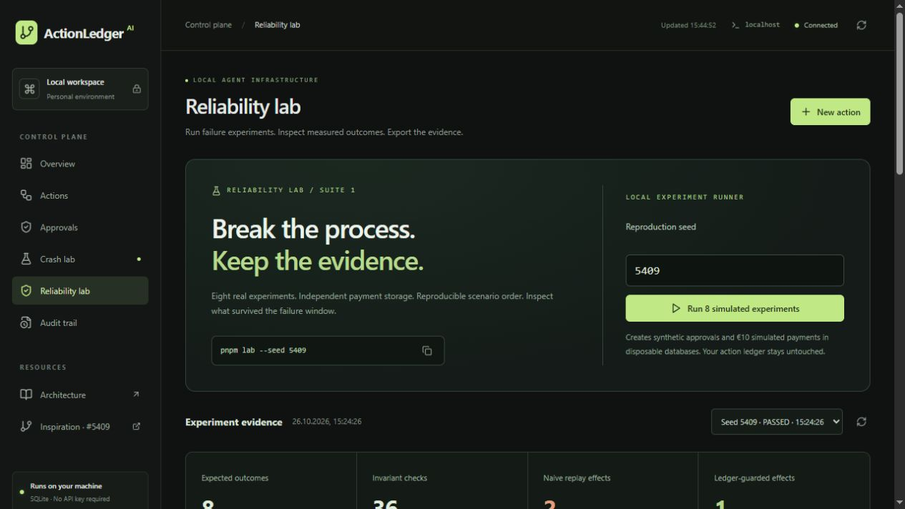
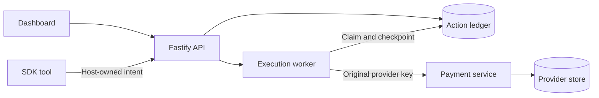

<div align="center">


# ActionLedger AI

### Durable intent. Conservative recovery.

An independent, local-first reliability framework for autonomous agent actions.

[Project presentation](docs/PROJECT-PRESENTATION.md) · [Logo assets](#brand-assets) · [Chaos evidence report](docs/evidence/chaos-stresstest-report.md) · [Get started](#quick-start) · [Enterprise architecture](#enterprise-architecture) · [Maintainer brief](docs/MAINTAINER-BRIEF.md) · [Releases](https://github.com/m4z8p6fy9m-coder/actionledger-ai/releases)

[](https://github.com/m4z8p6fy9m-coder/actionledger-ai/actions/workflows/ci.yml)
[](LICENSE)
[](https://nodejs.org/)

</div>

An agent executes a payment. The provider commits it. The agent crashes before saving the result. On restart, a retry can charge twice.

**ActionLedger makes that uncertainty explicit.** It persists business intent and human decisions independently of agent run state, returns recorded success, and blocks unsafe replay.

Inspired by [OpenAI Agents SDK issue #5409](https://github.com/openai/openai-agents-python/issues/5409). Independent open source; not affiliated with, endorsed by, or maintained by OpenAI.

## Multi-Agent Defensive Guard: Fencing Agent Race Conditions

When multiple agent hosts share the same ActionLedger runtime database, the optional MCP guard can serialize requests assigned to the same host-defined collision group. For each host-provisioned binding it computes `h = SHA-256(canonical({version: 1, promptHash, assetId}))`. A database uniqueness constraint admits one intent owner per `h`; a competing different intent receives `423 AgentCollisionLock` and a persistent `LOCKED` status. The agent cannot choose its own identity or collision hash through the MCP tool call.

An owner must reach verified `SUCCEEDED` and the configured minimum window must pass before a different intent may acquire the lock. An interrupted or UNKNOWN owner stays locked, even beyond the window. The blocked agent is never automatically invoked; a later explicit invocation can proceed only after those conditions are met. This prevents overlapping guarded dispatches for identical hashes, not sequential duplicate effects.

This is an exact comparison of the host-supplied `(promptHash, assetId)` pair, not a canonical-intent fingerprint, resource lock, vector embedding or semantic-equivalence detector. Different prompt hashes for the same asset will not collide. The lock key has no built-in tenant ID: use isolated databases or unambiguously tenant-qualified asset IDs, and do not treat that naming convention as full tenant isolation. Unguarded gateways, direct calls made before a collision is recorded, separate databases and external actors are outside its protection. All participating hosts must enforce the guard and provision consistent identities and hashes. It does not guarantee exactly-once execution or establish a product affiliation with OpenAI or Anthropic. See the [multi-agent experiment and benchmark](docs/MULTI-AGENT-EVIDENCE.md) and [runtime guidance](docs/ENTERPRISE-RUNTIME.md#multi-agent-guard) for reproducible checks, configuration and limitations.

## Resilience & Security Matrix

**Evidence, not a production certification:** the [PostgreSQL chaos stress-test report](docs/evidence/chaos-stresstest-report.md) records **24 / 24 simulated actions** with one payment and one POST each, zero observed duplicates, and all 24 uncertain outcomes held as `UNKNOWN`. PostgreSQL sessions were deliberately terminated; the Stripe API was a local mock.

| Invariant or boundary      | Mechanism                                                                                 | Evidence and limit                                                                                      |
| -------------------------- | ----------------------------------------------------------------------------------------- | ------------------------------------------------------------------------------------------------------- |
| Uncertain external effects | Never automatically re-dispatch UNKNOWN runtime actions; reconcile using reads            | 24 / 24 actions remained UNKNOWN in the recorded fault run                                              |
| Concurrent ownership       | Transactional claims and monotonic fencing reject stale checkpoints                       | PostgreSQL integration test; external effects still depend on provider behavior                         |
| Mutated MCP payload        | Compare supplied parameters with the host-registered intent; persist a freeze on mismatch | MCP tool reports 403 MutatedPayload; an already dispatched effect cannot be undone                      |
| Intent authenticity        | HMAC-SHA256 verifies causal manifest intents at startup                                   | Legacy non-causal intents may remain unsigned; the HMAC does not protect a compromised host or database |
| External idempotency       | Stable connector-scoped keys map from the host's causal fingerprint                       | The REST provider must enforce the key; Stripe retention and lookup limitations still apply             |

The recorded chaos experiment exercises selected fault schedules. It is not a mathematical proof, a real Stripe payment test, or a guarantee of exactly-once external execution.

## Quick start

Requires **Node.js 24+**, **pnpm 11.25.0**, and a modern browser.

```sh
pnpm install
pnpm dev
```

Open [localhost:5173](http://127.0.0.1:5173). The launcher starts the dashboard, API on port 4310, and separate payment provider on port 4311. Ctrl+C stops the services.

No Docker, cloud service, paid API, or OpenAI key. Initial dependency installation needs registry access; the application and demonstrations then run locally. Restart the launcher after backend or core changes.

## See the failure. Inspect the recovery.



The dashboard combines an action registry, explicit approval queue, audit trail, crash simulator, and an eight-scenario Reliability lab. Its statistics come from persistent records and observed provider requests.

1. Open **Crash lab**, select provider idempotency, and create a €10 scenario.
2. Review the exact payment and approve it.
3. Select **Execute & crash**. A real worker exits after the provider commits.
4. Recover with the original intent: **two attempts, one payment**.
5. Repeat without provider idempotency: **one payment, UNKNOWN, replay blocked**.

The separate **Reliability lab** runs isolated experiments, persists their results, exports evidence, and verifies report fingerprints. Fixture approvals apply only to disposable simulated payments. All payments are simulated.

## Enterprise Architecture

The optional runtime connects host-provisioned, immutable intents to external tools through the official Model Context Protocol SDK. A separate operator approves each action; the agent invokes only granted intent IDs. If an agent supplies an input or operation that differs from the registered intent, the MCP gateway returns a structured `403 MutatedPayload`, persists a freeze and blocks subsequent dispatch. No automatic unfreeze is provided.

For causal manifest intents, the host signs the complete intent with HMAC-SHA256 and the runtime verifies it at manifest load. This authenticates the host-provided intent; the gateway's payload comparison and freeze are separate runtime checks, not HMAC verification on every tool call. Existing non-causal intents can remain unsigned. A versioned fingerprint derived from prompt hash, state vector and intent ID maps to a connector-scoped provider key; changing an ID or causal state changes the fingerprint.

The runtime persists approvals, claims, fences and outcomes in SQLite or PostgreSQL. A recovery loop performs provider reads and records only verified evidence; UNKNOWN never causes automatic re-execution. Stripe and generic REST are optional connectors. The REST provider must enforce idempotency itself; a header alone does not establish that guarantee. The existing dashboard uses a separate SQLite ledger and does not automatically display or migrate enterprise runtime records.

See the [Enterprise Runtime guide](docs/ENTERPRISE-RUNTIME.md) for setup, threat boundaries and operational limitations. The runtime is an experimental foundation; live Stripe, Docker deployment and independent security assessment are not established by the recorded local tests.

## The recovery contract

The table below describes the original local dashboard engine; the optional enterprise runtime uses read-only reconciliation for UNKNOWN and never automatically re-dispatches it.

Local database transactions cannot guarantee exactly-once external execution. There is no atomic commit spanning the ledger and payment provider.

| Observed state                             | ActionLedger behavior                          |
| ------------------------------------------ | ---------------------------------------------- |
| Same key and immutable payload             | Return the existing action                     |
| Same key, changed payload or policy        | Reject the conflict before dispatch            |
| Pending approval or final rejection        | Do not dispatch                                |
| Recorded success                           | Return the saved receipt                       |
| Lost result or interrupted execution       | Preserve UNKNOWN                               |
| UNKNOWN with provider-enforced idempotency | Allow explicit recovery with the original key  |
| UNKNOWN without provider idempotency       | Block execution and recovery replay            |
| Concurrent or late workers                 | Enforce ownership and reject stale checkpoints |

Protected recovery has a five-attempt limit. The simulator retains keys indefinitely; real providers may expire or scope them differently. A missing receipt or negative lookup does not prove that no effect occurred. There is no force-retry or force-success override.

## Evidence you can run

### Real process-crash experiments

```sh
pnpm demo:reliability
pnpm lab --seed 5409 --output evidence.json
pnpm evidence:verify evidence.json
```

The lab uses independent temporary stores and a separate provider process. It exercises process exits, response loss after commit, provider errors, and competing workers. Saved dashboard runs survive restarts. A seed controls scenario order and payloads, not OS scheduling or receipt IDs. Fingerprints detect edits; they are not signatures or formal proofs.

### Actual Python Agents SDK

The optional fixture uses pinned **openai-agents 0.24.0**, real Runner, persisted approvals, RunState restoration, and actual process termination. A deterministic local Model replaces hosted inference.

```sh
# Requires Python 3.11–3.13 and uv
pnpm python:setup
pnpm demo:python
pnpm test:python
pnpm lint:python
```

| Scenario                                     | Observed payments | Outcome                 |
| -------------------------------------------- | ----------------: | ----------------------- |
| Deliberately unsafe comparison               |                 2 | Duplicate reproduced    |
| Ledger success before SDK checkpoint loss    |                 1 | Cached success          |
| Lost ledger checkpoint, protected provider   |                 1 | Safe recovery           |
| Lost ledger checkpoint, unprotected provider |                 1 | UNKNOWN; replay blocked |
| Persisted rejection                          |                 0 | No payment              |

The SDK and ledger approvals are separate gates. The host owns the durable intent ID and provider policy; the model cannot choose new retry keys or approve itself. See the [Python example](examples/openai-agents-python) and [TypeScript SDK adapter](examples/openai-agents-sdk).

### Minimized counterexamples

```sh
pnpm faults --seed 5409 --cases 24
pnpm faults --target unsafe-baseline --seed 5409 --expect-violation --output counterexample.json
pnpm faults replay counterexample.json
```

The unsafe comparison reduces to four necessary commands: create, approve, execute with lost evidence, and recover. Replay intentionally reports failure when it reproduces the duplicate.

The finder combines known crash-gap templates with seeded command noise. It uses injected exceptions around the real engine, rather than process kills. Single-removal minimality is checked within a bounded budget; it does not mean globally shortest. Output paths must not exist. Read the [fault-finder protocol](docs/FAULT-FINDER.md).

### Verified baseline

**Historical release baseline: 106 TypeScript tests · 7 Python adapter tests · 5 SDK scenarios.**

Application verification and Python regression passed on [Windows and Ubuntu](https://github.com/m4z8p6fy9m-coder/actionledger-ai/actions/runs/40355953336). Typecheck, lint, formatting, and production build passed. A separate state-machine suite exercises 1,280 seeded commands. These are bounded test observations, not a production certification.

## Architecture



TypeScript and Node.js · Fastify · React and Vite · Tailwind CSS · SQLite · Zod · Vitest · pnpm monorepo.

The ledger and provider have independent SQLite stores. Atomic transitions and ownership fencing protect local state; provider capabilities determine whether an uncertain external effect can be retried.

## Brand assets

The ActionLedger mark is available as a [transparent icon](docs/images/actionledger-icon.png), a [3D brand render](docs/images/actionledger-brand.png), and an editable [Blender scene](design/actionledger-logo.blend). The design is independent of OpenAI and Anthropic.

## Development

```sh
pnpm test
pnpm typecheck
pnpm lint
pnpm build
pnpm start       # Built app on http://127.0.0.1:4310
```

Stop development services before production mode; they share backend ports. Runtime files live in data/. Keep databases and their WAL/SHM files together. Stop services before copying the directory for a simple backup, and never publish credentials. See [local operations](docs/OPERATIONS.md).

| Read next                                    | Contents                                                 |
| -------------------------------------------- | -------------------------------------------------------- |
| [Maintainer brief](docs/MAINTAINER-BRIEF.md) | Reproduction, checkpoint boundaries, evidence and limits |
| [Architecture](docs/ARCHITECTURE.md)         | State machine, persistence and invariants                |
| [API reference](docs/API.md)                 | Authenticated endpoints and request shapes               |
| [Failure matrix](docs/FAILURE-MATRIX.md)     | Failure positions and expected outcomes                  |
| [Reliability lab](docs/RELIABILITY-LAB.md)   | Experiment protocol and evidence format                  |
| [Security](SECURITY.md)                      | Trust boundaries and reporting                           |
| [Contributing](CONTRIBUTING.md)              | Local development and contribution guidelines            |

## Scope

The original dashboard is a local reference implementation with a simulated payment action and explicit approval. The separate experimental runtime adds opt-in Stripe and REST connectors and provider-specific read-only reconciliation. Neither component provides production multi-user identity, a distributed queue, or tamper-proof audit storage. The Stripe connector has not been validated here against a real Stripe account.

Optional headless mode separates agent and operator credentials and disables browser credential bootstrap. It does not isolate code that can read host files or reach another operator service. Reviewer names provide attribution, not individual authenticated identities.

The action registry and approval queue cover the complete history. Overview, provider snapshots, and audit views show recent records; filtered CSV export is capped at 10,000 matching actions. Unprotected UNKNOWN has no resolution endpoint: retain evidence and reconcile externally.

---

[MIT license](LICENSE) · [Changelog](CHANGELOG.md) · Independent of OpenAI.
