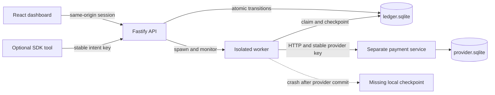

# ActionLedger AI

**Durable intent. Conservative recovery.** A fully local control plane for autonomous agent actions, built with TypeScript, Node.js, Fastify, React, Vite, Tailwind CSS, SQLite, Zod, and Vitest in a pnpm monorepo.

Independent open-source project. Not affiliated with, endorsed by, or maintained by OpenAI.

Inspired by [OpenAI Agents SDK issue #5409](https://github.com/openai/openai-agents-python/issues/5409): a tool can execute an approved external action, crash before storing its result, and execute it again on resume. ActionLedger persists logical intent, human decisions, worker ownership, and external evidence independently of agent run state.

## Version 0.3: reproducible reliability and scoped agent access

- Real OpenAI Agents SDK function-tool tests with tracing disabled and no model request. The SDK is a pinned development dependency; the app does not load it.
- Dropped connections, invalid responses, HTTP 500 after commit, real HTTP timeouts, pre-dispatch crashes, late workers, and concurrent recovery tests.
- Separate agent and operator credentials in optional headless mode; agent credentials cannot approve or read operator lists.
- Receipt validation inside the action engine for every adapter, including custom adapters.
- An isolated, assertion-backed process-crash demonstration: pnpm demo:reliability.

### Operator workflow

- Search and paginate the complete action ledger, including records older than the overview snapshot.
- Review all pending decisions in an independent, oldest-first approval queue.
- Export the complete filtered result set as a consistent CSV snapshot, up to 10,000 matching actions; narrow the filter for larger exports. Spreadsheet formula prefixes are neutralized.
- Inspect readable status tabs, sort order, page sizes, update timestamps, and keyboard-accessible action controls.
- Keep the last successful dashboard snapshot during connection failures. Requests have explicit deadlines, superseded reads are cancelled, and writes are never automatically replayed.
- Trace API responses using X-Request-Id. UI pages, forms, transport, and polling are split into reusable modules.

## Quick start

Prerequisites: **Node.js 24+** (built-in node:sqlite), **pnpm 11.25.0**, and a modern browser. Install Node and pnpm from their official distributions. The packageManager field pins pnpm; the lockfile is included. No native SQLite addon, Docker, cloud account, paid API, or OpenAI key is needed.

Run from the project root:

```sh
pnpm install
pnpm dev
```

Open **http://127.0.0.1:5173**. The launcher compiles core, creates private random local credentials, and starts the provider on 4311, API on 4310, and Vite on 5173. Execution workers are spawned as needed. These loopback ports must be free. Ctrl+C stops the launcher and its services.

Initial installation needs npm registry access. Once packages are installed, development, tests, builds, and the demo require no external services. The dashboard's inspiration link is deliberate external navigation. Frontend hot reload is enabled; restart pnpm dev after backend/core source changes.

```sh
pnpm test        # builds core, then runs offline reliability and API tests
pnpm typecheck   # strict TypeScript checks across all packages
pnpm lint        # ESLint, zero warnings
pnpm build       # compile core/provider/API and bundle React
pnpm start       # built app at http://127.0.0.1:4310
```

Stop pnpm dev before pnpm start because both use the same backend ports. pnpm start requires a successful build. The launcher supports Windows, macOS, and Linux; this release was verified on Windows with Node 24.

## Reproduce the actual crash window

The database starts empty. All statistics come from stored actions and actual local simulated provider requests. Nothing is seeded or fabricated. The source archive contains no runtime data or secrets.

1. Open **Crash lab → Provider idempotency** and create a €10 scenario.
2. **Review & approve** the exact payment, entering your reviewer name and decision reason. This saves approval without sending money.
3. **Execute & crash** starts a separate worker. The provider commits the payment receipt to provider.sqlite. After receiving the successful HTTP response, the worker calls process.exit(86) before saving ledger success.
4. The API observes the child exit and records UNKNOWN only for its owner token. Provider: **one payment**. Ledger: **no receipt**.
5. **Recover action** sends the original key and immutable payload. The provider returns the original receipt. Result: **SUCCEEDED, two attempts, one external payment**.
6. Switch to **No provider idempotency** and repeat. **Check recovery policy** returns UNSAFE_RETRY. The action remains **UNKNOWN, one attempt, one provider payment**. Execute/recover cannot replay it.

Reload the dashboard or restart the app at any step: intent, decisions, attempts, receipts, and audit persist. The browser remembers the latest demo per policy in localStorage. If the entire API dies with an active worker, request recovery after its 30-second lease expires. A live lease is never stolen. No background scheduler dispatches payments.

All payments are simulated; no real money moves. The dashboard also supports creating ordinary payment intents, explicit approval/rejection, normal execution, action inspection, per-attempt history, audit filtering, refresh, search, status filtering, and CSV export.

## One-command reliability demonstration

Run pnpm demo:reliability. It uses fresh temporary SQLite stores and random loopback ports, approves two synthetic €10 demonstration intents as the CLI operator, terminates real workers with exit code 86, reopens the API, and asserts payment counts and recovery policies. It never opens your runtime data directory. Stores and services are cleaned up afterward. Incorrect invariants exit nonzero. See [failure matrix](docs/FAILURE-MATRIX.md).

## Scoped agent mode

Run pnpm dev:headless, or pnpm start:headless after building. This starts the API and provider without the dashboard or browser credential bootstrap. The launcher creates a private data/agent-token.txt. Give only this token to the trusted agent host. Keep data/secrets.json and its operator/provider credentials outside the agent sandbox. The SDK wrapper accepts baseUrl, token, and a durable application-owned intentId.

The scoped token permits POST /api/actions, GET /api/actions/:id, and POST execution/recovery for approved intents. Approval, history lists, audit, export, and monitoring require the operator token. Human review uses authenticated operator REST requests; see [API reference](docs/API.md). There is no approval UI in headless mode. Never run default browser-bootstrap mode against the same stores while relying on scoped credential separation. Switching modes requires stopping and restarting.

This is API credential separation for trusted hosts. It does not isolate an agent that can read operator files, execute arbitrary host code, or access another operator service. Reviewer names remain attribution rather than separately authenticated human identities.

## Guarantee boundary

**SQLite transactions do not guarantee exactly-once external execution.** There is no atomic commit spanning the ledger and provider databases.

| Condition                              | Behavior                                                            |
| -------------------------------------- | ------------------------------------------------------------------- |
| Same key + same normalized payload     | Return the existing action; audit the duplicate                     |
| Same key + different payload or policy | 409 KEY_CONFLICT; never dispatch                                    |
| Missing approval or rejected intent    | Never dispatch                                                      |
| Concurrent workers                     | Atomic claim permits one owner; checkpoint requires the same owner  |
| Known success                          | Return saved receipt with no provider request                       |
| Lost response or interrupted worker    | UNKNOWN; missing evidence never implies no effect                   |
| UNKNOWN + provider idempotency         | Explicit recovery may reuse the same key, up to five attempts total |
| UNKNOWN + unprotected provider         | Block replay; retain UNKNOWN indefinitely                           |
| Expired lease                          | Mark UNKNOWN; provider capability still controls safe recovery      |
| Late old worker result                 | Reject stale checkpoint                                             |

The simulator retains provider keys indefinitely and binds them to the payload. Real providers may expire keys, scope them to an account, or offer weaker guarantees. Validate their semantics before writing adapters. A negative lookup is not finality evidence: the original request may still settle. There is intentionally no force-retry, force-success, reset, or delete operation that erases uncertainty.

## Architecture



See [detailed architecture](docs/ARCHITECTURE.md), [API reference](docs/API.md), and [security model](SECURITY.md).

```text
apps/server/       Fastify API, process supervisor, execution worker
apps/provider/     Independent persistent HTTP payment service
apps/web/          React control plane and crash lab
packages/core/     SQLite stores, action identity, transitions, approval policy
scripts/           Cross-platform local process launcher
examples/          Optional SDK tool and tested plain HTTP adapter
tests/             Engine, provider, HTTP, and real process-crash tests
```

## Persistence and operations

Runtime files live in data/. Set DATA_DIR to an absolute path before launch to use a different directory. Both databases use WAL and synchronous=FULL with a five-second busy timeout.

- ledger.sqlite: actions, final decisions, attempts, application audit.
- provider.sqlite: simulated payments, retained provider keys, request counts.
- secrets.json: separate random bearer tokens. Never commit or share this file.

Keep each SQLite file and its WAL/SHM files together. For a simple consistent backup, stop the app cleanly and copy the whole data directory. Use a local filesystem, not a network share. A disk administrator can alter database and audit content. Server logs are structured and redact authorization headers. Node may emit a SQLite experimental warning on some supported versions.

## Optional SDK integration

[examples/openai-agents-sdk](examples/openai-agents-sdk) has a plain HTTP adapter and optional tool wiring based on the [official SDK quickstart](https://developers.openai.com/api/docs/guides/agents/quickstart). Neither is loaded by the default app. Each tool instance is bound to an application-owned intent ID persisted before the agent runs. The model cannot choose a new retry key, and the wrapper never approves its own action.

The offline suite invokes the real, pinned @openai/agents 0.21.0 function-tool API and validates approval, rejection over restart, crash recovery, immutable payload conflicts, input validation, and concurrent invocations. Tracing is disabled and the test rejects non-loopback fetches. It does not invoke a model or test a hosted agent run. SDK tests use Zod 4; core retains its separate Zod 3 dependency.

## Scope and limitations

This is a tested, production-style local MVP, not a production payment gateway. It provides one payment action type, one simulated provider, explicit decisions, and manual safe recovery. It does not include real payment adapters, provider-specific authoritative reconciliation, automatic dispatch scheduling, multi-user identities and general-purpose RBAC, encrypted storage, remote deployment, tamper-proof audit storage, or a distributed queue. The default dashboard operator token can approve and execute; reviewer names are recorded but not separately authenticated. Optional headless mode provides a distinct scoped agent token, not operating-system isolation or individual human identities. Protect the machine and data directory.

The overview, audit view, and provider receipt snapshot show the latest 200 records. The action registry and approval queue page through the complete history. Filtered CSV export reads a consistent snapshot of up to 10,000 matching actions and rejects larger exports explicitly. The audit API supports cursors. Global metrics use all records. The UI polls every three seconds while visible; background polling does not overlap. Unprotected UNKNOWN has no resolution endpoint: preserve evidence and investigate externally instead of risking a duplicate.

See [CONTRIBUTING.md](CONTRIBUTING.md). MIT licensed.

Release history: [CHANGELOG.md](CHANGELOG.md).
