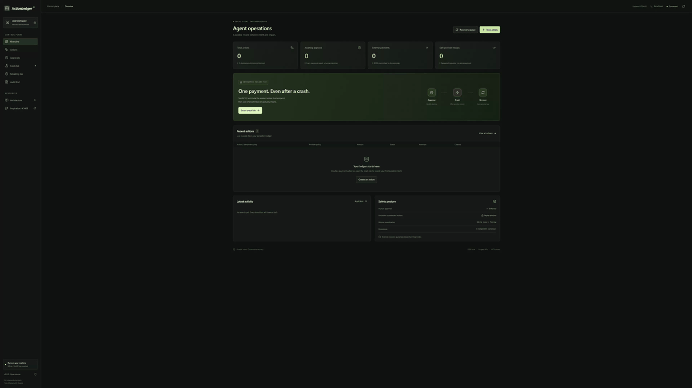
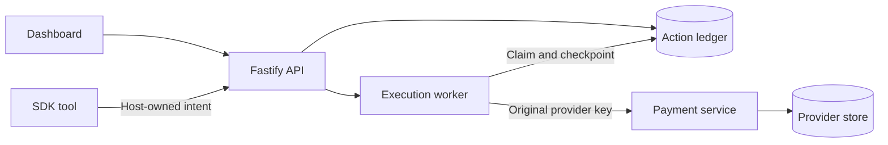

<div align="center">


# ActionLedger AI

**Make uncertain agent actions visible. Avoid blind retries.**

Local-first AI agent reliability: crash recovery, idempotency, and human-in-the-loop approvals.

[](https://github.com/m4z8p6fy9m-coder/actionledger-ai/actions/workflows/ci.yml)
[](LICENSE)
[](https://nodejs.org/)

</div>

A provider completes a payment. The agent crashes before saving the result. On restart, a blind retry can pay twice. ActionLedger records the uncertainty as `UNKNOWN`: the local demo blocks replay when the provider cannot deduplicate, and permits an **explicit** recovery with the original key when its simulated provider enforces idempotency.

The dashboard and reliability lab use simulated payments. The separate MCP/runtime integrations are **experimental**. This independent open-source project is not affiliated with or endorsed by OpenAI; it is not a production-certified SDK, and this repository does not provide an npm installation path.

<div align="center">

<a href="docs/videos/actionledger-live-demo-final.mp4"></a>

[Watch the full demo with sound](docs/videos/actionledger-live-demo-final.mp4) · [Quick start](#quick-start) · [How recovery works](#the-recovery-contract) · [Evidence](docs/VERIFICATION.md)

</div>

The preview plays silently. The recording uses the local dashboard and a separate simulated provider; the cursor, sound and final safety label are presentation overlays.

```text
Intent + human approval → provider commits → worker crashes before checkpoint
                                             ↓
                                      ledger: UNKNOWN
                          ┌──────────────────┴────────────────────┐
              provider enforces key                    no idempotency
              explicit same-key recovery               replay blocked; inspect evidence
```

No local database transaction can guarantee exactly-once external execution. A missing result or a timeout does not prove that the provider did nothing.

## Quick start

Requires **Node.js 24+**, **pnpm 11.25.0**, Git, and a modern browser. Dependency installation needs registry access; the demo itself is local and needs no paid API, Docker or OpenAI key.

```sh
git clone https://github.com/m4z8p6fy9m-coder/actionledger-ai.git
cd actionledger-ai
pnpm install --frozen-lockfile
pnpm dev
```

Open [localhost:5173](http://127.0.0.1:5173). The launcher starts the dashboard, API on port 4310, and separate simulated provider on port 4311; stop them with Ctrl+C. It persists local records in `data/`, including credentials; do not share that directory. For a disposable, assertion-backed crash reproduction without the UI, run `pnpm demo:reliability`.

In **Crash lab**, create a €10 scenario, review and approve it, then select **Execute & crash**. With provider idempotency, **Recover action** uses the original key. In **No provider idempotency** mode, recovery refuses replay and keeps `UNKNOWN`. Every payment is simulated.

## What is implemented

- **Durable intent and approvals:** persist immutable action identity, a human decision, attempts and audit records.
- **Conservative crash recovery:** preserve ambiguous outcomes; replay in the local demo requires explicit recovery and simulated provider deduplication.
- **Reliability lab and fault injection:** run isolated process-crash and response-loss scenarios, export evidence and minimize selected counterexamples.
- **Agent integrations:** a local REST adapter and offline examples for the OpenAI Agents SDK; no hosted model is required for the examples.
- **Optional experimental runtime:** an MCP gateway, read-only reconciliation, SQLite/PostgreSQL storage, optional connectors and a scoped multi-agent guard.

## Two separate execution paths

| Local dashboard and lab                                                                                               | Optional experimental runtime                                                                                                                  |
| --------------------------------------------------------------------------------------------------------------------- | ---------------------------------------------------------------------------------------------------------------------------------------------- |
| Fastify API and React dashboard use one SQLite ledger; a separate provider has its own SQLite store.                  | Host-provisioned intents pass through an MCP gateway and a separate runtime ledger in SQLite or PostgreSQL.                                    |
| The simulator can explicitly retry an UNKNOWN action with the original key only when provider idempotency is enabled. | UNKNOWN recovery uses provider reads and does not automatically re-dispatch; unresolved cases may require operator investigation.              |
| Intended for local, simulated experiments.                                                                            | Optional Stripe/REST connectors, signatures and multi-agent fencing are experimental; tests do not establish real Stripe or production safety. |

The stores and dashboards are not automatically shared or migrated. The optional guard compares host-bound `(promptHash, assetId)` pairs; different prompt hashes on the same asset do not collide. It does not provide tenant isolation or protect direct provider calls. See [runtime architecture](docs/ENTERPRISE-RUNTIME.md), [multi-agent evidence and limits](docs/MULTI-AGENT-EVIDENCE.md), and [security review](docs/SECURITY-REVIEW.md).

The failure window was discussed in [OpenAI Agents Python issue #5409](https://github.com/openai/openai-agents-python/issues/5409). The issue is closed: [PR #5424](https://github.com/openai/openai-agents-python/pull/5424) added upstream recovery guidance without changing runtime behavior. ActionLedger supplies separate, locally reproducible experiments; it is not an official SDK component.

For integration see the [local REST quickstart](docs/INTEGRATION-QUICKSTART.md). Independent developers can use the [reproduction checklist](docs/INDEPENDENT-REPRODUCTION.md) and [report actual results](https://github.com/m4z8p6fy9m-coder/actionledger-ai/issues/new?template=independent-reproduction.md); no independent verification is claimed until reports are received.

## Reproduce the evidence

On 28 October 2026, a Windows local run against source at base commit `e520cf3` passed `pnpm check` with **146 TypeScript tests passed and one PostgreSQL test skipped**. The same run passed 13 separate Python adapter tests and five offline Python SDK scenarios. The local lab passed eight scenarios and 36 checks; all provider effects were simulated. See [verification history](docs/VERIFICATION.md) for exact commands, environment, CI, historical releases and limitations.

```sh
pnpm demo:reliability
pnpm lab --seed 5409 --output evidence.json
pnpm evidence:verify evidence.json
```

The lab output path must not already exist. PostgreSQL integration, chaos, Python tests and real providers have separate prerequisites; a skipped test is not a pass.

## The recovery contract

The table below describes the original local dashboard engine; the optional enterprise runtime uses read-only reconciliation for UNKNOWN and never automatically re-dispatches it.

Local database transactions cannot guarantee exactly-once external execution. There is no atomic commit spanning the ledger and payment provider.

| Observed state                             | ActionLedger behavior                          |
| ------------------------------------------ | ---------------------------------------------- |
| Same key and immutable payload             | Return the existing action                     |
| Same key, changed payload or policy        | Reject the conflict before dispatch            |
| Pending approval or final rejection        | Do not dispatch                                |
| Recorded success                           | Return the saved receipt                       |
| Lost result or interrupted execution       | Preserve UNKNOWN                               |
| UNKNOWN with provider-enforced idempotency | Allow explicit recovery with the original key  |
| UNKNOWN without provider idempotency       | Block execution and recovery replay            |
| Concurrent or late workers                 | Enforce ownership and reject stale checkpoints |

Protected recovery has a five-attempt limit. The simulator retains keys indefinitely; real providers may expire or scope them differently. A missing receipt or negative lookup does not prove that no effect occurred. There is no force-retry or force-success override.

## Evidence you can run

### Real process-crash experiments

```sh
pnpm demo:reliability
pnpm lab --seed 5409 --output evidence.json
pnpm evidence:verify evidence.json
```

The lab uses independent temporary stores and a separate provider process. It exercises process exits, response loss after commit, provider errors, and competing workers. Saved dashboard runs survive restarts. A seed controls scenario order and payloads, not OS scheduling or receipt IDs. Fingerprints detect edits; they are not signatures or formal proofs.

### Actual Python Agents SDK

The optional fixture uses pinned **openai-agents 0.24.0**, real Runner, persisted approvals, RunState restoration, and actual process termination. A deterministic local Model replaces hosted inference.

```sh
# Requires Python 3.11–3.13 and uv
pnpm python:setup
pnpm demo:python
pnpm test:python
pnpm lint:python
```

| Scenario                                     | Observed payments | Outcome                 |
| -------------------------------------------- | ----------------: | ----------------------- |
| Deliberately unsafe comparison               |                 2 | Duplicate reproduced    |
| Ledger success before SDK checkpoint loss    |                 1 | Cached success          |
| Lost ledger checkpoint, protected provider   |                 1 | Safe recovery           |
| Lost ledger checkpoint, unprotected provider |                 1 | UNKNOWN; replay blocked |
| Persisted rejection                          |                 0 | No payment              |

The SDK and ledger approvals are separate gates. The host owns the durable intent ID and provider policy; the model cannot choose new retry keys or approve itself. See the [Python example](examples/openai-agents-python) and [TypeScript SDK adapter](examples/openai-agents-sdk).

### Minimized counterexamples

```sh
pnpm faults --seed 5409 --cases 24
pnpm faults --target unsafe-baseline --seed 5409 --expect-violation --output counterexample.json
pnpm faults replay counterexample.json
```

The unsafe comparison reduces to four necessary commands: create, approve, execute with lost evidence, and recover. Replay intentionally reports failure when it reproduces the duplicate.

The finder combines known crash-gap templates with seeded command noise. It uses injected exceptions around the real engine, rather than process kills. Single-removal minimality is checked within a bounded budget; it does not mean globally shortest. Output paths must not exist. Read the [fault-finder protocol](docs/FAULT-FINDER.md).

### Verified baseline

**Historical v0.5.0 baseline (26 October 2026): 106 TypeScript tests · 7 Python adapter tests · 5 SDK scenarios.** The tag points to `7a13ac57c27a4aa78567a198d352977732b488fc`; see [verification history](docs/VERIFICATION.md) for later runs and their scope.

Application verification and Python regression passed on [Windows and Ubuntu](https://github.com/m4z8p6fy9m-coder/actionledger-ai/actions/runs/40355953336). Typecheck, lint, formatting, and production build passed. A separate state-machine suite exercises 1,280 seeded commands. These are bounded test observations, not a production certification.

## Architecture



TypeScript and Node.js · Fastify · React and Vite · Tailwind CSS · SQLite · Zod · Vitest · pnpm monorepo.

The ledger and provider have independent SQLite stores. Atomic transitions and ownership fencing protect local state; provider capabilities determine whether an uncertain external effect can be retried.

## Brand assets

The ActionLedger mark is available as a [transparent icon](docs/images/actionledger-icon.png), a [3D brand render](docs/images/actionledger-brand.png), and an editable [Blender scene](design/actionledger-logo.blend). The design is independent of OpenAI and Anthropic.

## Development

```sh
pnpm test
pnpm typecheck
pnpm lint
pnpm build
pnpm start       # Built app on http://127.0.0.1:4310
```

Stop development services before production mode; they share backend ports. Runtime files live in data/. Keep databases and their WAL/SHM files together. Stop services before copying the directory for a simple backup, and never publish credentials. See [local operations](docs/OPERATIONS.md).

| Read next                                    | Contents                                                 |
| -------------------------------------------- | -------------------------------------------------------- |
| [Maintainer brief](docs/MAINTAINER-BRIEF.md) | Reproduction, checkpoint boundaries, evidence and limits |
| [Architecture](docs/ARCHITECTURE.md)         | State machine, persistence and invariants                |
| [API reference](docs/API.md)                 | Authenticated endpoints and request shapes               |
| [Failure matrix](docs/FAILURE-MATRIX.md)     | Failure positions and expected outcomes                  |
| [Reliability lab](docs/RELIABILITY-LAB.md)   | Experiment protocol and evidence format                  |
| [Security](SECURITY.md)                      | Trust boundaries and reporting                           |
| [Contributing](CONTRIBUTING.md)              | Local development and contribution guidelines            |

## Scope

The original dashboard is a local reference implementation with a simulated payment action and explicit approval. The separate experimental runtime adds opt-in Stripe and REST connectors and provider-specific read-only reconciliation. Neither component provides production multi-user identity, a distributed queue, or tamper-proof audit storage. The Stripe connector has not been validated here against a real Stripe account.

Optional headless mode separates agent and operator credentials and disables browser credential bootstrap. It does not isolate code that can read host files or reach another operator service. Reviewer names provide attribution, not individual authenticated identities.

The action registry and approval queue cover the complete history. Overview, provider snapshots, and audit views show recent records; filtered CSV export is capped at 10,000 matching actions. Unprotected UNKNOWN has no resolution endpoint: retain evidence and reconcile externally.

---

[MIT license](LICENSE) · [Changelog](CHANGELOG.md) · Independent of OpenAI.
