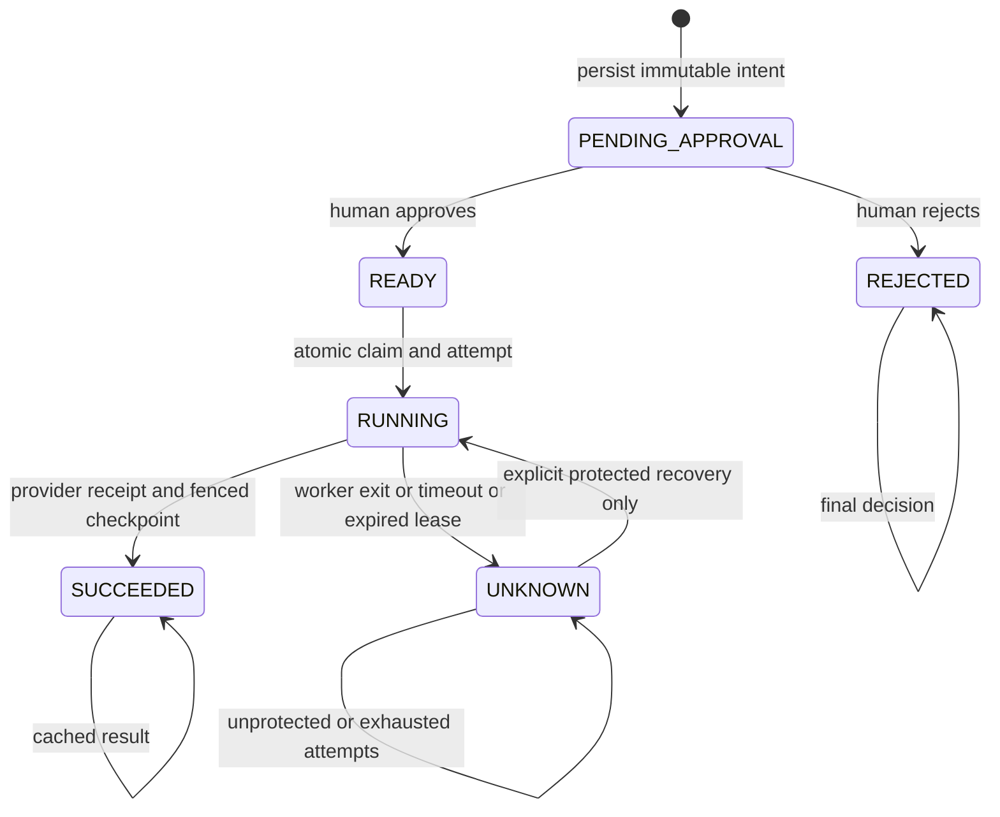
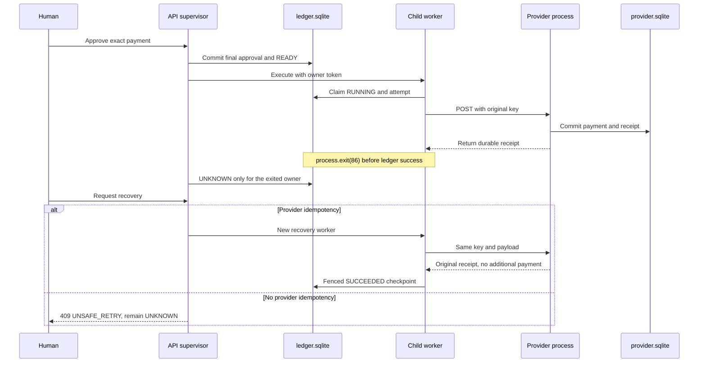

# Architecture and invariants

## State machine

## Durable identity and policy

The normalized Zod payload includes the logical key, recipient, integer cents, currency, description, and immutable provider policy. A deterministic SHA-256 fingerprint binds all fields. A unique SQLite key plus BEGIN IMMEDIATE makes duplicate lookup, creation, and audit atomic across connections. Normalization trims text and supplies explicit defaults. Clients must never generate a new logical key just because execution was interrupted.

Every payment is HIGH risk. Clients cannot submit a risk downgrade. Approval and rejection are final and stored once per immutable action. Repeating the same decision is idempotent. Reviewer and reason are recorded, but the MVP does not authenticate a separate human principal.

## Dispatch and fencing

An atomic claim records RUNNING, a unique owner token, a 30-second lease, and an attempt. Dispatch follows transaction commit. No SQLite transaction stays open across HTTP. A five-second provider timeout bounds the expected request wait, but a paused worker or provider can outlive either timeout or lease.

The success transaction updates only a RUNNING action with that owner token, recording receipt, attempt completion, and audit together. Tokens fence stale local writes, not external provider calls. An unprotected provider never receives a second dispatch after uncertainty. Protected overlapping requests depend on provider key retention and enforcement.

Leases use wall-clock milliseconds. Clock changes may affect availability; they never authorize unprotected replay. Real long-running adapters need an explicit heartbeat policy without weakening uncertainty rules.

## Crash experiment

The API survives the demo worker crash. If the entire API dies, RUNNING may remain until explicit recovery expires its abandoned lease. Provider evidence persists independently. Tests exercise observed child exits and reopened abandoned leases.

## Retry contract

No automatic dispatch loop exists. An operator or adapter explicitly requests recovery. READY can execute after approval. UNKNOWN can recover only with immutable idempotent provider policy and fewer than five previous attempts. SUCCEEDED returns its cached receipt. Every ambiguous provider failure becomes UNKNOWN, including failures that may have happened before dispatch. This intentionally prioritizes safety over availability.

Unprotected UNKNOWN never returns to READY and cannot be manually marked succeeded/failed through this MVP. Real authoritative reconciliation would need evidence that the original request completed or cannot ever settle. A missing lookup result does not suffice; no such proof is fabricated here.

## Independent storage

Both stores use WAL, synchronous=FULL, foreign keys, and a five-second busy timeout. Atomic groups are synchronous and contain no await. Unique attempt owners and unique action/attempt-number pairs protect local history. The provider separately commits lookup, payload comparison, payment, and request count.

During normal operation only the provider process opens provider.sqlite; the API/workers open ledger.sqlite. Unit tests instantiate stores directly. Integration tests cross real HTTP and independent files with actual child workers. Schema version 1 is initialized on first use; this MVP has no upgrade migrations yet.

The React UI is not a policy authority. All approval, key binding, execution eligibility, and retry limits are enforced below REST. A local token protects API data and mutations; a separate token protects the provider. This is a single-operator trusted-machine demo, not a multi-tenant security boundary.

The API imposes a 12-second child-worker deadline and terminates stalled workers. A claimed attempt without a durable result remains UNKNOWN. Provider receipts are schema-validated and checked against the approved recipient, amount, and currency before checkpointing.

## Dashboard and query boundaries (0.2)

The overview snapshot is an operational summary, not the source of truth for full-history browsing. Dedicated paginated reads power the action registry and oldest-first approval queue. Count and rows share a short SQLite transaction. Filtered export similarly reads one consistent snapshot and enforces a 10,000-row bound; it never truncates silently.

React pages, forms, and display components are separate from the HTTP client and polling hooks. The transport coalesces session bootstrap, bounds request time, handles structured errors, and never retries a mutation automatically. Polling retains the last successful snapshot, cancels superseded reads, avoids overlapping background requests, and pauses when the document is hidden. A rendering error boundary offers a reload path without changing persisted action state.

Offset pagination is deterministic within each request but is not a frozen multi-request snapshot: concurrent inserts can shift later pages. Use the transactional export for a consistent filtered download. SQLite's built-in lower() provides ASCII case-insensitive search, not language-aware Unicode collation.
