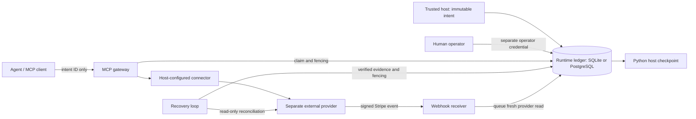

# Optional enterprise runtime

ActionLedger is an independent open-source project and is not affiliated with OpenAI. This experimental runtime is a separate deployment surface alongside the existing local dashboard. It is designed around conservative recovery; it has not been certified for production or independently audited.

## Architecture and trust boundaries



The host provisions a fixed ID, operation, connector and payload. The agent cannot create an intent, alter its payload, approve it, configure an upstream or replace credentials. A human operator makes and records each decision. Only an approved READY action can dispatch. Execution and reconciliation acquire a lease with a monotonic fence; stale workers cannot commit outcomes. The external provider must itself provide the relevant duplicate protection: a local database transaction and fencing cannot make an external effect exactly once.

The runtime uses its own tables and database. Existing dashboard/API records stay in the original SQLite ledger: there is no automatic migration or shared dashboard view. PostgreSQL support applies to this runtime, not the original dashboard. Generic connector implementations are trusted code, so the host must review their semantics and permissions.

## Local setup

Node.js 24 and pnpm 11.25.0 are required. The existing offline dashboard remains available with `pnpm install && pnpm dev`. Build the runtime with `pnpm build`. Its sample manifest is [config/runtime.example.json](../config/runtime.example.json); the simulated connector requires an independently running local provider and a matching `PROVIDER_TOKEN` of at least 32 characters. Configure `ACTIONLEDGER_MANIFEST` to point at a host-owned manifest. Without `DATABASE_URL`, the runtime uses `RUNTIME_DB` or `data/runtime.sqlite`; setting `DATABASE_URL` selects PostgreSQL.

An MCP client can launch the server through stdio with the absolute path to `packages/runtime/dist/cli.js` and argument `stdio`, using `node` directly. Pass the manifest path and needed connector credentials in the child process environment. Do not put secrets in the manifest or expose stdio to untrusted hosts. The MCP server exposes `actionledger_status` and `actionledger_invoke`, each accepting only `{ "intentId": "..." }`. Use a distinct HTTP process for operator decisions; processes sharing a runtime database share decisions and fencing.

For the operator API set distinct random `RUNTIME_OPERATOR_TOKEN` and `RUNTIME_AGENT_TOKEN` values, each at least 32 characters, then run `pnpm runtime http`. The default listener is `127.0.0.1:4312`. The agent credential can only read; the operator credential can record a decision:

```sh
curl -H "Authorization: Bearer $RUNTIME_AGENT_TOKEN" http://127.0.0.1:4312/v1/intents/invoice-demo-001
curl -X POST -H "Authorization: Bearer $RUNTIME_OPERATOR_TOKEN" \
  -H 'Content-Type: application/json' \
  -d '{"decision":"approve","actor":"operator","reason":"Reviewed the invoice"}' \
  http://127.0.0.1:4312/v1/intents/invoice-demo-001/decision
```

`GET /health` returns 503 when recovery is stopped or degraded. Webhook delivery uses `POST /stripe/webhook` with the original raw request body and Stripe signature. Other endpoints require a bearer credential and reject browser Origin headers. The service does not implement TLS, enterprise identity, per-user roles, multi-tenant isolation or rate limiting; protect it with a properly configured authenticated TLS ingress and restrict network access. Never expose the operator token to the agent.

## Docker Compose and PostgreSQL (optional)

Docker is not required for the offline core. For a disposable local Compose demonstration, with Docker Compose installed:

```sh
pnpm install
node scripts/init-runtime-env.mjs
docker compose --env-file deploy/.env up -d --build --wait
node scripts/compose-smoke.mjs
docker compose --env-file deploy/.env down
```

The env generator creates unique credentials and refuses to overwrite an existing file. Keep `deploy/.env` private. Compose binds the gateway to local port 4312, starts PostgreSQL and a separate persistent simulated provider, and keeps provider HTTP on container loopback. The smoke test is for a fresh stack: it approves a disposable simulated payment, invokes it over actual MCP, repeats the invocation and checks that the provider received one payment. It changes the fixture's persisted state. Named volumes survive `down`; deleting volumes destroys the ledger and provider data. The Compose and CI configurations are examples, not hardened production deployment templates.

## Stripe connector

Stripe is opt-in and never used by the default demo. Add a `stripe` object to the host manifest (`{ "liveMode": false }` for test mode) and host-created intents using connector `stripe`, operation `payment.create`, and input `{ "amountCents": 1000, "currency": "eur", "customer": "cus_...", "paymentMethod": "pm_..." }`. Supply `STRIPE_SECRET_KEY` and `STRIPE_WEBHOOK_SECRET` as environment secrets; key type must match the explicit live-mode setting. An optional connected-account ID can be set as `stripe.account`. The host namespace, account, mode and SDK API version are bound to the immutable intent. Only Stripe customer and payment method identifiers are accepted; do not put card data in a manifest.

The adapter derives a stable provider idempotency key from the host intent and scoped binding. It disables SDK retries in the configured client and records success only after validating an authenticated PaymentIntent and its binding. Network failures, rate limits, 409s, ambiguous provider responses and nonterminal statuses remain UNKNOWN. A confirmed cancellation can be REJECTED. Webhooks are signature-checked with a five-minute tolerance, checked against account and mode, deduplicated durably and trigger a fresh authenticated read; a webhook body alone cannot declare success.

Stripe does not offer a general authoritative lookup by idempotency key. Recovery can retrieve a known PaymentIntent or search bound metadata and then retrieve an exact match. Stripe search is eventually consistent and may not be available everywhere; a missing, ambiguous or unverifiable result stays UNKNOWN and is never automatically re-executed. Provider idempotency keys have limited retention, so never assume retry safety after an extended outage. See Stripe's [idempotency](https://docs.stripe.com/api/idempotent_requests), [PaymentIntent search](https://docs.stripe.com/api/payment_intents/search) and [webhook signature](https://docs.stripe.com/webhooks/signature) documentation. Real Stripe credentials and live payments are not part of the automated tests.

## MCP upstream connectors

The manifest may configure `upstreams` with an ID, Streamable HTTP URL, optional `tokenEnv` variable name, and a `tools` map from allowed operation names to JSON input schemas. HTTPS is required except for loopback HTTP; URLs cannot contain credentials. Only explicitly allowlisted tools can run, and input is host-provisioned and schema validated. Optional `finalitySchemas` map operation names to JSON schemas for the upstream's `structuredContent`. Without a matching, host-reviewed finality schema and matching structured result, a response stays UNKNOWN even when the MCP call itself returned without an error. A schema is a trust assertion: it must distinguish a completed external effect from an acknowledgement. Generic MCP tools have no universal authoritative recovery API, so UNKNOWN is not replayed automatically.

## Recovery, Python and operations

The recovery loop runs after restart and uses bounded, read-only provider checks. When an UNKNOWN outcome is persisted, the runtime emits the structured critical event `CRITICAL_UNKNOWN_RECONCILIATION_REQUIRED` on stderr. Operators should review the Stripe or REST provider dashboard, or another authoritative provider source, and must not force an automatic retry. The event contains the intent ID, connector ID and sanitized outcome code, but no action payload or credentials. Logging is best effort; the durable audit record remains authoritative. It updates the ledger only with verified evidence; no universal autonomous resolution is possible where the provider supplies no authoritative evidence. The Python example's `RuntimeClient` reads using the agent credential and atomically saves only a confirmed success to an application-owned checkpoint. `make_result_tool` wraps that reader as an OpenAI Agents SDK tool. The host must restart or resume its agent and arrange the checkpoint location; the runtime does not reconstruct an arbitrary SDK RunState or start a dead process.

Durability of the ledger and provider identity is essential. Protect persistent volumes, configure suitable PostgreSQL TLS, roles, backups and recovery point objectives, and ensure clocks are synchronized. Restoring an older ledger snapshot can lose dispatched intents and make duplicate effects possible; reconcile against external systems before resuming. Webhook deduplication records currently have no automated retention policy. Assess monitoring, secret rotation, capacity, migrations and disaster recovery before use. Independent security review, real Stripe sandbox validation, operational load testing and deployment hardening remain necessary.

## Verification

`pnpm check` runs TypeScript, lint, formatting, tests and build. `pnpm test:postgres` runs PostgreSQL integration tests when `TEST_DATABASE_URL` points to a disposable database; tests create runtime tables. For the optional Python adapter use `pnpm python:setup`, `pnpm lint:python`, `pnpm typecheck:python` and `pnpm test:python`. The test suite includes local SDK protocol tests, mocked Stripe HTTP, signed webhook cases and separate worker process crashes. CI defines additional PostgreSQL and Compose smoke jobs; their presence does not prove a particular local deployment has been tested.

## Causal identity, signed intents and mutation freezes

A host can add `causal: { promptHash, stateVector }` to an intent. `promptHash` is a lowercase SHA-256 hex digest supplied by the host, and `stateVector` is host-defined JSON. Versioned canonical JSON derives a provider-independent SHA-256 fingerprint from these fields and the intent ID. The runtime durably maps that fingerprint to the connector-scoped provider key in the same transaction as intent registration. Stripe and generic REST connectors both consume the mapped key. An intent remains bound to one connector and immutable payload; switching providers is not automatic and can cause a second effect. Identical business actions given different intent IDs or different causal states have different fingerprints, so callers must preserve identity across restarts. Hashing causal state cannot infer whether two independently created requests represent the same business action.

Causal manifest intents must carry an HMAC-SHA256 `signature` over the complete canonical intent without the signature field. The runtime verifies it at manifest load with `ACTIONLEDGER_SIGNING_KEY` (at least 32 bytes); use a high-entropy secret managed by the host. The exported `signIntent` helper computes the signature. The HMAC authenticates the manifest against whoever possesses the shared secret; it is not an asymmetric signature and does not protect a compromised host, process or database. Existing non-causal unsigned manifests remain supported for compatibility and do not gain this signature guarantee. Rotate keys with an explicit re-signing plan. Do not include signing keys in manifests, logs or agent environments.

For `actionledger_invoke`, an agent may optionally supply `input` and `operation`. They must exactly match the registered host intent. A mismatch returns an MCP tool error with structured `statusCode: 403` and `error: MutatedPayload`, and records a persistent freeze and audit event; MCP stdio has no actual HTTP status code. Subsequent dispatch is blocked, including direct runtime dispatch. There is currently no automatic unfreeze API: investigate using an operator-controlled recovery procedure. A freeze cannot undo a request already sent before the mismatch; reconciliation can still record evidence for that request. Because an allowed agent can trigger a freeze, rate limits and stronger per-agent authorization are required for hostile multi-tenant deployments.

The optional generic REST connector requires a host-configured fixed endpoint, operation and input JSON Schema, and sends the connector-scoped key in `Idempotency-Key`. HTTPS is required outside loopback. The host must establish separately that the provider enforces that header: the header alone cannot guarantee idempotency. A host-defined finality schema is required to classify a response as success; otherwise a 2xx is UNKNOWN. Without an authoritative read integration, recovery remains UNKNOWN and does not replay. Connector schemas and the target service are trusted configuration.

## Isolated chaos experiment

`pnpm test:chaos` requires `TEST_DATABASE_URL` pointing to a disposable loopback PostgreSQL database and `CHAOS_DISPOSABLE=YES`. It creates uniquely named intents and preserves them as evidence. It uses a local Stripe HTTP fixture that commits simulated payments then drops responses, and terminates only PostgreSQL backend sessions created by this test immediately before selected transaction commits. It checks that each intent has one POST, one simulated payment and no automatic redispatch after reconciliation. It exercises specific fault schedules, not all possible network failures or a mathematical proof of exactly-once execution. Never run it on a shared or production database.

The [chaos evidence report](evidence/chaos-stresstest-report.md) records the observed 24-action experiment and its limits. The observed consistency applies only to that run; it is not a mathematical or formal 100% certification. REST providers must enforce idempotency themselves. Existing non-causal intents remain unsigned for compatibility, and no automated unfreeze is provided for `403 MutatedPayload`.

## Multi-agent guard

The optional `multiAgent` host-manifest object supplies `windowMs` (0–86400000; default 1000) and `bindings`, one for every granted intent. Each binding contains `intentId`, host-assigned `agentId`, lowercase SHA-256 `promptHash`, and canonical host-selected `assetId`. The gateway derives SHA-256 of canonical JSON `{version: 1, promptHash, assetId}`; agent tool arguments cannot override these values. The host is responsible for computing and protecting them, and for making the same assignments across participants.

```json
{
  "windowMs": 1000,
  "bindings": [
    {
      "intentId": "intent-a",
      "agentId": "agent-a",
      "promptHash": "aaaaaaaaaaaaaaaaaaaaaaaaaaaaaaaaaaaaaaaaaaaaaaaaaaaaaaaaaaaaaaaa",
      "assetId": "invoice:42"
    },
    {
      "intentId": "intent-b",
      "agentId": "agent-b",
      "promptHash": "aaaaaaaaaaaaaaaaaaaaaaaaaaaaaaaaaaaaaaaaaaaaaaaaaaaaaaaaaaaaaaaa",
      "assetId": "invoice:42"
    }
  ]
}
```

This example is the value of the `multiAgent` property alongside the normal manifest fields. On dispatch of an approved READY intent, the gateway atomically acquires a persistent database lock for the hash. A competing intent receives the MCP structured error `423 AgentCollisionLock`; the block and audit entry are durable, and the operator log emits `CRITICAL_MULTI_AGENT_COLLISION_DETECTED_FENCING_ENGAGED` on stderr. Status reads report `LOCKED` for a blocked READY intent. Its underlying ledger state remains READY with zero attempts, since no external outcome is unknown. Direct dispatch of an already blocked intent is also refused by the claim operation.

A lock transfers only after the current owner is confirmed SUCCEEDED and the configured minimum window has elapsed. It never expires while an owner is pending, running, rejected or UNKNOWN, even after a restart. A blocked action is not dispatched automatically. After transfer is permitted, a new explicit invocation can execute a second intent: this guard serializes overlapping guarded actions; it does not deduplicate sequential actions. Investigation and a separately designed administrative recovery procedure are required for permanently unresolved locks; there is no automated override.

The key has no built-in tenant ID: namespace asset IDs unambiguously per tenant or use separate databases, and do not mistake key namespacing for full tenant isolation. Different prompt hashes for the same asset do not collide. The key is not the canonical intent fingerprint and does not include operation or payload. See the [lock contract](MULTI-AGENT-EVIDENCE.md#chosen-lock-contract-and-tenant-boundaries). The feature is opt-in for compatibility. Every participant must use the configured MCP gateway and the same durable database and hash policy; calls that bypass it before a block exists and external actors cannot be fenced. Equality of hashes is not semantic similarity, a vector clock, or proof that differently worded requests are distinct. Stable collision-resistant hashes, trusted host identity, database durability and an external provider's guarantees remain necessary. This is not a distributed consensus protocol or a universal exactly-once guarantee.
