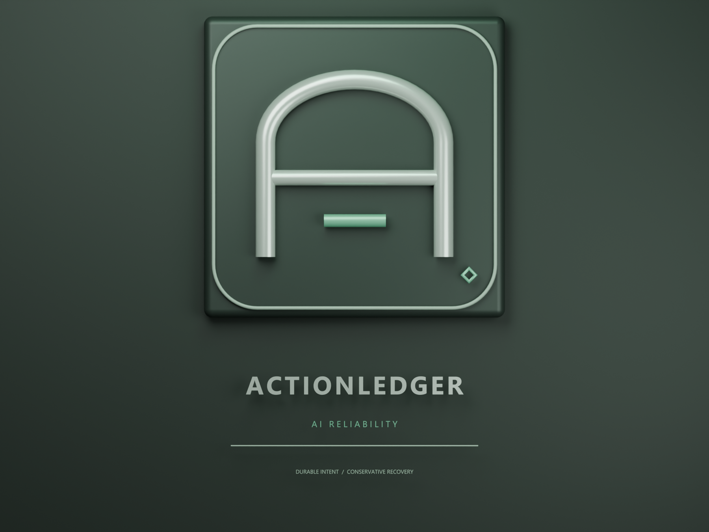
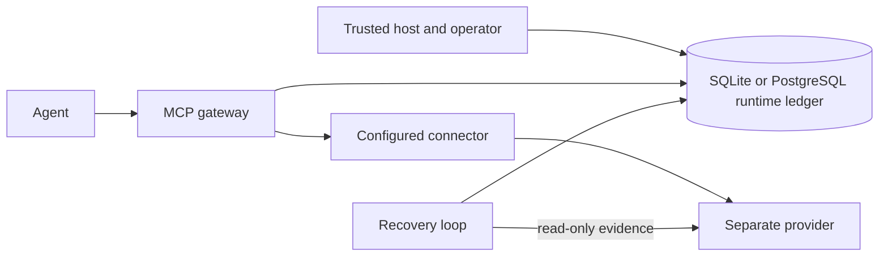

# ActionLedger AI — project presentation

**Durable intent. Conservative recovery.**



A reproducible, local-first demonstration of safer external actions for autonomous agents. Independent open source; not affiliated with OpenAI or Anthropic.

## 1. The failure window

An agent requests a payment. The provider commits it. Before the local result is checkpointed, the process crashes. On restart, blindly repeating the request can create a second payment. Local database transactions cannot atomically commit an external provider's state.

**The design question:** What should an agent do when the external outcome is uncertain?

## 2. The recovery contract

- Persist a host-owned intent and explicit human decision before dispatch.
- Return a recorded success; do not execute an unapproved action.
- Represent missing evidence as `UNKNOWN` rather than guessing.
- Fence stale local owners; use provider evidence and idempotency where available.
- In the optional runtime, reconcile `UNKNOWN` using reads and never automatically re-dispatch it.

## 3. Architecture



The optional enterprise runtime is separate from the original SQLite dashboard ledger. The agent uses host-provisioned intents; it cannot grant itself approval. Stripe and generic REST connectors are optional. The default demo uses a separate local simulated provider and requires no paid API or OpenAI key.

## 4. Live demo — multi-agent collision

Requires Node.js 24+, pnpm 11.25.0 and installed dependencies.

```sh
pnpm install
pnpm demo:multi-agent
```

The script creates disposable local fixtures and shows two separate host processes contending for one intent. It then runs two MCP clients: Agent A executes, Agent B receives `423 AgentCollisionLock`, and the ledger and audit entry are printed. Once A succeeds, B explicitly invokes again. A separate uncertain outcome remains blocked. The demo writes its SQLite fixture under ignored `work/`.

For the dashboard crash gap, run `pnpm dev`, open `http://127.0.0.1:5173`, and use **Crash lab**. With provider idempotency, recovery records one simulated payment. Without it, uncertainty remains `UNKNOWN` and replay is blocked.

## 5. Historical evidence from local runs

| Experiment                             | Observation                                                                                                                             |
| -------------------------------------- | --------------------------------------------------------------------------------------------------------------------------------------- |
| Full TypeScript verification           | 146 tests passed, 1 PostgreSQL-specific test skipped in a 27 October 2026 local run; PostgreSQL had passed separately in an earlier run |
| Mock Stripe and local PostgreSQL chaos | 24 actions, 24 POSTs, 24 simulated payments, 24 UNKNOWN outcomes                                                                        |
| Multi-agent contention                 | One lock owner for the same host-defined group in local SQLite/PostgreSQL tests                                                         |
| Python regression                      | 13 unit tests and five offline SDK scenarios passed in a prior local run                                                                |

These are historical observations; the exact local commits for these presentation counts were not recorded. See the [verification record](VERIFICATION.md) for dated runs, the [chaos report](evidence/chaos-stresstest-report.md) and [multi-agent evidence and benchmark](MULTI-AGENT-EVIDENCE.md). These are bounded local observations, not formal proofs or a production certification.

## 6. What the multi-agent guard does — and does not do

The optional guard groups requests by the host-provided pair `(promptHash, assetId)`. Matching pairs share a lock. Different prompt hashes for the same asset do not. This is not semantic similarity, a canonical intent fingerprint, or general resource serialization. Equal pairs can also over-block different actions.

The guard has no built-in tenant ID or tenant authorization. A tenant-qualified asset ID may scope its key, but does not provide full tenant isolation. All participating hosts must use the guard and the same durable database; direct calls or external actors can bypass it.

## 7. Production boundaries and next steps

- Provider-side idempotency is essential where retries are allowed. A REST header by itself is not a guarantee.
- Stripe search may be eventually consistent or unavailable; missing evidence remains UNKNOWN. Real Stripe integration was not exercised in the local mock test.
- There is no generic automatic force-unlock for unresolved outcomes. Operators must inspect provider evidence and retain the lock until a supported, verified resolution exists.
- Host identities and connector code are trusted. The system does not provide built-in enterprise identity, full multi-tenant isolation or tamper-proof audit storage.
- The local benchmark measures guard acquisition, not end-to-end production capacity. Independent security review, deployment hardening and recovery planning remain necessary.

## 8. Explore

- [README and quick start](../README.md)
- [Enterprise runtime setup and trust boundaries](ENTERPRISE-RUNTIME.md)
- [Multi-agent experiment, raw measurements and manual recovery](MULTI-AGENT-EVIDENCE.md)
- [Failure evidence](evidence/chaos-stresstest-report.md)
- [Security policy](../SECURITY.md)
